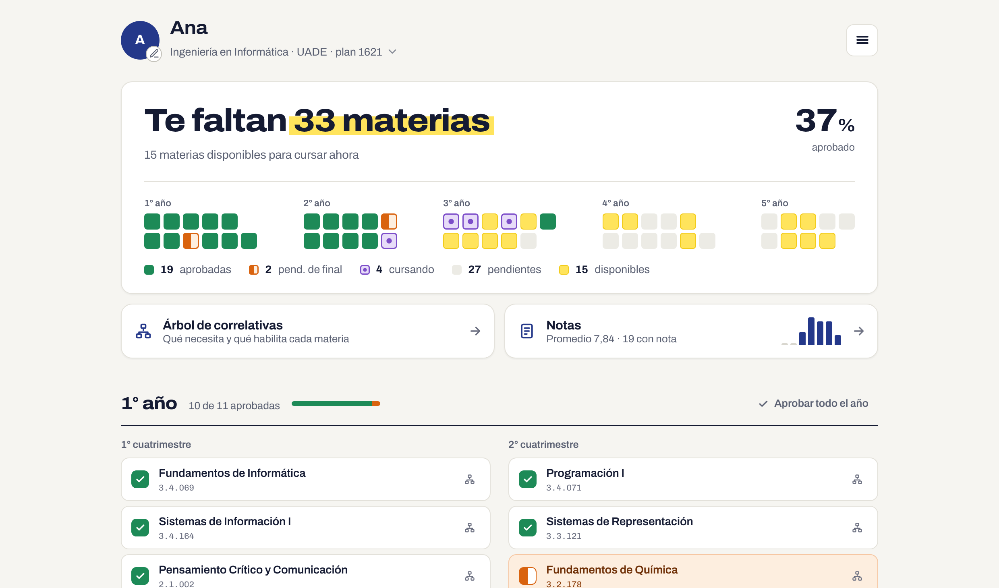
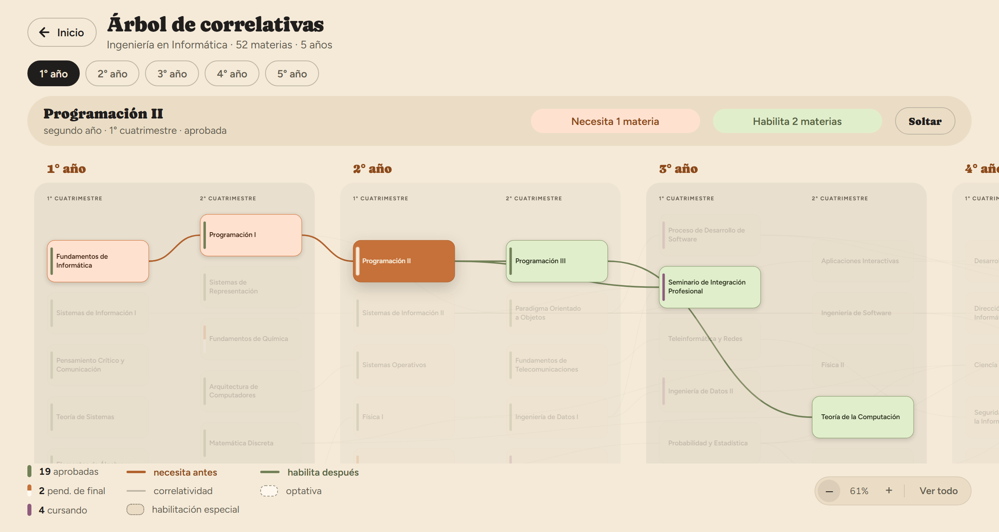

# 5 · Diseño visual y UX

## 5.1 Identidad

El nombre es la pregunta que todo estudiante se hace — **¿Cuánto me falta?** — y la aplicación entera está diseñada para responderla de un vistazo. La identidad visual se llama **Libreta** (noviembre de 2026): el plan de estudios como una libreta bien impresa. **Papel claro, tinta azul marino y un resaltador amarillo** — las tres cosas que cualquier estudiante tiene en la mochila. El tono de la interfaz es rioplatense e informal ("Marcá tus materias", "¿Cuánto me falta?"), porque le habla a estudiantes, de igual a igual; lo que la mantiene seria es la estructura: una grilla clara, jerarquía tipográfica y nada decorativo.

Tres decisiones ordenan todo lo demás:

1. **El amarillo es el resaltador, y no hace otra cosa.** Marca lo que importa *ahora*: la respuesta a "¿cuánto me falta?" y lo que ya se puede cursar. Siempre es un fondo con tinta encima —sobre el papel da 1,3:1, no se lee como texto ni como trazo—, y por eso el foco, los links y los botones son de tinta.
2. **La materia es un casillero.** La misma forma —un cuadrado con la esquina apenas redondeada— es la casilla de cada fila, la celda del mapa de la carrera, el glifo de la leyenda y el ícono de la app. Lo único redondo es el avatar, porque es una persona y no una materia.
3. **Los estados conservan su familia de color** (verde, naranja, violeta): quien ya usaba la aplicación no tuvo que aprender nada de nuevo.

Libreta reemplaza a *Organic* (septiembre de 2026: crema, terracota, una serif de fantasía hasta en los botones y todo en forma de píldora), que se leía como una plantilla genérica y no como una herramienta.

## 5.2 Tipografías

| Fuente | Rol | Uso |
|---|---|---|
| **Archivo** (sans, variable) | Toda la interfaz | Texto, botones y formularios en su ancho normal; títulos y números grandes en negrita y un 8 % más ancha |
| **Chivo Mono** (mono) | Datos técnicos | Códigos de materia (ej. `3.4.069`), versión de la app |

Las dos son de **Omnibus-Type**, una fundidora argentina, y se cargan desde Google Fonts con `display=swap` para no bloquear el renderizado. Que sea **una sola familia** es deliberado: la voz de los títulos no es otra fuente sino la misma, más pesada y más ancha (`--display-ancho`). Los botones usan siempre la tipografía de texto: un botón dice qué hace, no hace de título.

El signo **¿** del ícono no es texto: es el contorno real del glifo de Archivo ExtraBold convertido a trazo (`src/components/Logo.tsx`), para que el logo sea idéntico en la app, en el favicon y en el ícono instalado, donde no hay ninguna fuente cargada.

## 5.3 Design tokens

Todo el sistema vive como variables CSS al principio de `src/styles/global.css`, la única fuente de verdad: colores, tipografías, radios y sombras, con **cero colores literales** en el cuerpo del archivo (ADR-16). Ningún componente —tampoco los que dibujan el árbol o el logo desde TypeScript— escribe un color a mano; la única excepción es el logo de Google, que es una marca ajena.

**Base**

| Token | Valor | Uso |
|---|---|---|
| `--paper` | `#f6f5f1` | Fondo general; también `theme-color` de la PWA |
| `--card` | `#ffffff` | Tarjetas, filas y superficies |
| `--ink` | `#151b33` | Texto principal (15,6:1 sobre el papel) |
| `--soft` | `#5b6173` | Texto secundario (5,7:1) |
| `--line` | `#e3e1da` | Líneas y bordes suaves |
| `--tinta` | `#24388a` | **Color de marca**: botones primarios, foco, links, lo elegido (10,5:1 sobre blanco) |
| `--resalta` | `#ffe45c` | **El resaltador**: solo como fondo, con `--ink` encima (13,4:1) |

**Estados y relaciones** — cada concepto tiene una terna `color / fondo / texto` para usarse en glifos, fondos y tipografía con contraste correcto:

| Concepto | Terna | Valores | Texto sobre su fondo |
|---|---|---|---|
| Aprobada | `--ap` / `--ap-bg` / `--ap-tx` | `#1d8a57` / `#e7f4ed` / `#0f5236` | 8,1:1 |
| Cursando | `--cu` / `--cu-bg` / `--cu-tx` | `#7c4dc9` / `#f2ecfb` / `#43247e` | 10,1:1 |
| Pendiente de final | `--fi` / `--fi-bg` / `--fi-tx` | `#d9630f` / `#fdeedf` / `#6f3007` | 8,8:1 |
| Necesitás (prerrequisito) | `--lk` / `--lk-bg` / `--lk-tx` | `#d9630f` / `#fde6d2` / `#8a3d0a` | 6,3:1 |
| Habilita (dependiente) | `--hb` / `--hb-bg` / `--hb-tx` | `#1d8a57` / `#dcf0e4` / `#14613f` | 6,3:1 |

**Forma**

| Token | Valor | Uso |
|---|---|---|
| `--r-xs` | 4px | Celdas del mapa, etiquetas |
| `--r-sm` | 6px | Chips, casilleros de nota |
| `--r-md` | 10px | Botones, campos, filas de materia |
| `--r-lg` | 14px | Tarjetas, menús, modales |
| `--sombra-1` / `--sombra-pop` | — | Dos sombras cortas: lo que apenas se despega del papel y lo que flota (menús, hojas) |

No hay píldoras: `999px` queda solo para lo que es una barra o un riel.

**Derivados** — el resto son familias: neutros de superficie (`--sunk`, `--line-fuerte`, `--card-hover`), la familia de la tinta (`--tinta-tx`, `--tinta-fuerte` y sus tres tintes), el **rojo de peligro** (el único de la aplicación), el ámbar de los avisos de la administración, los avisos flotantes y los tintes de cada sentido de correlativa. Tres detalles que conviene no volver a mezclar:

- **`--card` y `--sobre-color` no son el mismo blanco**, aunque hoy tengan el mismo valor: una es una **superficie** y la otra es **tinta sobre un fondo saturado**. El día que la superficie se oscurezca, la tinta no la sigue.
- **Los `--*-rgb`** (`--tinta-rgb`, `--ink-rgb`, …) existen porque `rgba()` no acepta un `var()` de color.
- **La hoja del PDF tiene su propia paleta de papel** (`--px-*`), declarada dentro de `#print-summary` para que no se filtre a la pantalla.

## 5.4 El color como lenguaje

La decisión de diseño central: **el color codifica significado de manera consistente en toda la aplicación**. Verde siempre es aprobada; violeta, cursando; naranja, pendiente de final. En las correlativas, naranja es lo que una materia *necesita* antes y verde lo que *habilita* después. El mismo código rige en el listado del plan, en el mapa de la carrera, en los paneles de correlativas, en el árbol, en el editor de la administración y en el resumen imprimible — una vez aprendido, se lee sin leyenda.

**Dos reglas que hereda cualquier paleta futura**, y que `src/styles/paleta.test.ts` mide leyendo los tokens reales (ΔE2000 con vista normal, protanopia y deuteranopia, y contraste WCAG):

- **Ningún estado se distingue por el color solo.** Siempre lo acompaña una forma: casilla vacía (pendiente), punto (cursando), mitad llena (final), tilde (aprobada). Los glifos se dibujan —un trazo SVG y formas de CSS—, no son caracteres: "✓" y "•" no están en la tipografía y cada sistema los resolvía con una fuente distinta.
- **Un color, un trabajo.** Violeta es *cursando* y no aparece como acento de nada más; el rojo está reservado para lo destructivo; el amarillo es solo el resaltador.

**Qué se pinta y qué no.** La fila de una materia no se tiñe entera por estado, salvo cuando la materia está "viva" (cursando o con el final pendiente). Lo aprobado queda en blanco con su tilde y lo que todavía no se puede cursar se apaga un paso: en el plan de alguien avanzado, lo que salta a la vista es lo de este cuatrimestre y no una pared de verde.

## 5.5 La administración

La administración usa el mismo lenguaje visual, y esa continuidad es una decisión, no una economía: quien carga un plan ve **la grilla del estudiante, editable**, y marca las correlativas **sobre el mismo árbol** que después va a ver el alumno, con los mismos naranja y verde.

- **Se escribe sobre la fila, sin formularios.** Código, nombre, año y cuatrimestre se editan en la grilla; `Tab` pasa a la siguiente. Menos clics es literalmente el criterio de aceptación: cargar una carrera de ~40 materias en menos de dos horas.
- **Elegir la dirección antes de tocar.** Para conectar una correlativa se elige la materia y el sentido (*necesita* / *habilita*), y entonces la aplicación **ilumina lo conectable y apaga el resto**. Reusa el lenguaje de color que el usuario ya aprendió y hace imposible dibujar una flecha inválida.
- **Una franja de tres pasos** —*cargá las materias · marcá qué necesita cada una · revisá y publicá*— dice dónde se está y qué falta. El paso 2 **no muestra un porcentaje**: no existe un denominador honesto, porque las materias de primer año no tienen previas y están bien así.
- **El panel de cambios dice y la grilla muestra.** Antes de publicar se ve la lista de qué va a cambiar para los alumnos, redactada en castellano, con un signo por tipo y deshacer por cambio.
- **Los diálogos son propios, no del navegador.** Un `confirm()` nativo no puede mostrar **la lista** de qué se rompe ni pintar de rojo lo destructivo; los ocho que había se reemplazaron por confirmaciones con la estética de la app.
- **La acción va en el pie del panel.** El botón que grita *apretame* tiene que ser el que publica: cuando "Listo" era el primario y "Publicar" estaba a mitad del cuerpo, la posición de más peso visual no hacía nada.
- **Los mensajes hablan en nombres, no en códigos.** "Programación I (3.4.071) pide Fundamentos (3.4.069)": el nombre para leer, el código para encontrarla en la grilla.

## 5.6 Decisiones de interfaz

- **Selector de estado con lenguaje de estudiante.** Las opciones no son solo etiquetas: cada una se explica en primera persona ("La estoy cursando ahora", "Aprobé la cursada, me falta rendir"). Elimina ambigüedad sin manual.
- **Avisos que proponen el paso siguiente.** El aviso de correlativas no es un error: dice exactamente qué falta y ofrece un botón para ver el árbol con foco en esa materia. Informar + accionar en el mismo gesto.
- **Paneles de correlativas múltiples.** Se pueden abrir varios a la vez para comparar materias — la consulta real nunca es de a una.
- **El tablero responde la pregunta del título.** "Te faltan 33 materias", con palabras y resaltado, y el porcentaje al lado: la respuesta a "¿cuánto me falta?" está arriba de todo, siempre.
- **El mapa de la carrera en lugar de un gráfico genérico.** Debajo de la respuesta, un casillero por materia, agrupados por año y con una fila por cuatrimestre. Una dona decía "37 %" y nada más; el mapa dice lo mismo y además *dónde* está ese avance, qué se está cursando y qué ya se podría cursar (lo amarillo). Es el plan entero en 60 px de alto.
- **Onboarding guiado que termina en acción.** Tour de coach marks en la primera visita, repetible a demanda desde Opciones; nunca vuelve a interrumpir solo. El paso de cierre no explica: invita a marcar la primera materia y abre ahí mismo el selector de estado — el tutorial desemboca en la acción que arranca el uso (activación), no en una despedida.
- **Dos tutoriales cortos, no uno largo.** La administración reusa el mismo recorrido de coach marks del estudiante, pero partido en dos —la lista (3 pasos) y el editor (4)— cada uno con su marca de visto y en el momento en que hace falta. El del editor explica **solo lo que la franja de tres pasos no dice**: que se escribe inline, que las correlativas se marcan sobre el árbol y dónde se revisa antes de publicar. Un tutorial en contexto es lo que permite que el manual sea corto.
- **Lo destructivo, separado y confirmado.** Reiniciar el progreso está aparte en el menú y pide confirmación; el rojo aparece en el botón de *esa* confirmación, no en el ítem del menú — el rojo queda para cuando algo está por perderse o salió mal.
- **Resumen pensado para papel.** La vista de impresión no es la pantalla "como salga": es un documento propio, diseñado con `@media print`, con identidad, métricas y materias por estado.

## 5.7 Responsive y accesibilidad

- Diseño mobile-first: el uso típico es en el teléfono, entre clases. En pantallas angostas el encabezado se compacta (los botones conservan solo el ícono) para priorizar el nombre y la carrera.
- Contenedor de lectura acotado (`max-width: 980px`) para líneas cómodas en escritorio.
- Menús con roles ARIA (`role="menuitem"`), cierre con `Escape` en superficies modales (árbol) y foco visible con un anillo de tinta, uno solo para toda la aplicación.
- Las ternas de color de estado incluyen una variante de texto oscurecida (`-tx`) para asegurar contraste sobre los fondos suaves.

## 5.8 Extensión de la identidad

La identidad no termina en la pantalla principal. Siguen el mismo sistema, y salen de los mismos valores: el **ícono** de la app, el favicon y la **imagen de compartir** (`scripts/gen-icons.mjs`, que repite la paleta de `global.css` y hay que volver a correr si cambia), las páginas de **Privacidad** y **Términos**, y el **resumen en PDF**.

Queda **pendiente fuera del repositorio**: el formulario de feedback (Tally) se había personalizado con la paleta anterior y hay que pasarlo a `--paper`, `--ink` y `--tinta` desde su panel.
